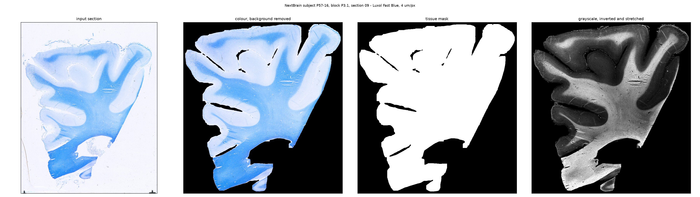

# cleanslide

Artifact removal and tissue masking for histology sections, producing
registration-ready images. One pipeline for any dataset and any stain: the
processing stages are fixed, every parameter is a physical size in micrometres.

Input is a [BIDS microscopy](https://bids-specification.readthedocs.io/en/stable/modality-specific-files/microscopy.html)
dataset; output is a BIDS derivative.

## Example

One section in, three outputs out:



NextBrain subject P57-16, block P3.1, section 09 — Luxol Fast Blue at 4 µm/px.
Note that the outputs are cropped to the tissue while the input is not; the crop
origin is recorded in the sidecar so coordinates map back to the source scan.
See [Data and attribution](#data-and-attribution).

## Installation

Not on PyPI yet. Install from the repository:

```bash
pip install git+https://github.com/spittayapong/cleanslide.git
```

Python 3.10 or newer. The core install pulls in numpy, opencv-python-headless
and scipy — nothing that needs a display, so it runs on a compute node.

Two optional extras:

| Extra | Adds | For |
|---|---|---|
| `cleanslide[qc]` | matplotlib | the QC panels, `--qc` |
| `cleanslide[test]` | pytest | running the test suite |

If you use `--qc` without matplotlib, cleanslide stops right away and tells you
to install `cleanslide[qc]`. It checks this before it starts on the first
section, so a long run never fails halfway through.

## Input

A BIDS microscopy dataset. A minimal one looks like this:

```
dataset/
├── dataset_description.json
├── participants.tsv
├── samples.tsv
├── sub-01/
│   └── micr/
│       ├── sub-01_sample-A1_stain-LFB_BF.tif
│       ├── sub-01_sample-A1_stain-LFB_BF.json
│       ├── sub-01_sample-A2_stain-LFB_BF.tif
│       └── sub-01_sample-A2_stain-LFB_BF.json
└── sub-02/
    └── micr/
        ├── sub-02_sample-B1_BF.tif        # no stain entity: also fine
        └── sub-02_sample-B1_BF.json
```

What the pipeline reads, and from where:

| What | Source | Required |
|---|---|---|
| subject | the `sub-<label>` entity | yes |
| section | the `sample-<label>` entity | yes |
| image | a file ending `_BF`, with a `<same stem>.json` beside it | yes |
| **pixel size** | sidecar `PixelSize` + `PixelSizeUnits` | **yes — no default** |
| stain | `stain-<label>` entity, and sidecar `SampleStaining` | no — both optional |

The stain is read from both places and required in neither. The label is
copied to the output filename and sidecar, but no stage reads it, so the same
parameters run on any stain.

Accepted image formats are `.tif`, `.tiff` and `.png`. **Not JPEG** — BIDS does
not permit it for microscopy. Convert before building the dataset; re-wrapping a
JPEG as TIFF does not restore what the JPEG lost, but it does make the dataset
valid.

Labels must be alphanumeric, which is worth knowing when your own identifiers
contain dots or hyphens: `P3.1` section `09` has to become something like
`sample-P3109`, and that cannot be split again. Record the original form in
`samples.tsv` so it is not lost.

### Pixel size is mandatory, and it matters more than anything else here

Every filter in the pipeline is specified as a physical size and converted to
pixels through the section's own pixel size.

A wrong pixel size **does not raise an error**. It silently rescales every
filter at once, so the pipeline runs to completion and removes the wrong
objects.

`cleanslide` therefore refuses a section whose scale it cannot read, rather than
assuming one. If `PixelSize` is missing from a sidecar, that section is an error.

## What it does

Per section, in order:

| Stage | What it removes or produces |
|---|---|
| `tissue_mask` | luminance threshold → blur → Otsu → morphological open, then drop printed charts, labels and debris; crop to the tissue |
| `remove_bubbles` | round mounting-medium bubbles, filtered by area and circularity, then inpainted |
| `smooth_mask` | regularise the mask outline so the masked tissue has no ragged pixel border |
| `to_masked_rgb` | the colour section with the background blacked out |
| `to_inverted_gray` | invert, so tissue appearance looks close to T1-weighted MRI |
| `normalise` | stretch the tissue to the full range, by percentile |
| `suppress_folds` | tissue folds and thin bright laminae, via grayscale opening *(off by default)* |
| `enhance` | CLAHE inside the mask, or a sigmoid contrast curve |

## Usage

A BIDS App, so the three positional arguments are the convention:

```bash
cleanslide <bids_dir> <output_dir> participant
```

Options:

| Option | Effect |
|---|---|
| `--participant-label LABEL [...]` | subjects to process, without the `sub-` prefix; default is all of them |
| `--qc` | also write QC panels |
| `--qc-dir DIR` | where panels go; default `<output_dir>/qc` |
| `--enhance {clahe,sigmoid}` | intensity stage, default `clahe` |
| `--suppress-folds` | delete bright structures narrower than the fold size; intended for cerebellar sections |

For example, two subjects with QC:

```bash
cleanslide data/bids derivatives/cleanslide participant \
    --participant-label 01 02 --qc
```

## Outputs

A BIDS derivative. Per section, under `<output_dir>/sub-<label>/micr/`:

| File | What |
|---|---|
| `…_desc-clean_BF.tif` | 8-bit grayscale, deflate — inverted, stretched, background 0. What a registration step consumes. |
| `…_desc-tissue_mask.tif` | 8-bit, deflate — 0 or 255. |
| `…_desc-cleanrgb_BF.tif` | 8-bit RGB, deflate — the colour section with the background removed |
| `…_desc-clean_BF.json` | the sidecar |

Plus `<output_dir>/dataset_description.json`, which BIDS requires of a
derivative.

The sidecar carries `PixelSize`, `PixelSizeUnits`, `SampleStaining`, `Sources`,
`GeneratedBy`, `OutputFormatVersion`, the fully resolved `Parameters`, and
`Measurements` — everything the run estimated or counted, including the crop
origin, the mask area in mm², how many components were dropped and why, and how
many bubbles were found against how many were kept.

The sidecar is authoritative for the pixel size. The TIFF resolution tags carry
the same value so a file opens correctly in Fiji or QuPath on its own, but a
reader should prefer the sidecar.

### QC

`--qc` writes two PNGs per section:

- `<section>_outputs.png` — the three outputs side by side
- `<section>_qc.png` — every stage in order

The stage panel is how you answer "is the mask right on my data?", which is the
first question a new dataset raises. Look at it before trusting a batch run.
[`notebook/demo_cleaning_one_section.ipynb`](notebook/demo_cleaning_one_section.ipynb)
walks through the same thing interactively on one section.

### Why the grayscale output is inverted

Not cosmetic. These sections are registered to a T1 MRI, so the cleaned image is
made to resemble a T1 as closely as possible.

| | white matter | grey matter | background |
|---|---|---|---|
| T1 MRI | bright | darker | dark |
| stained histology | **dark** (myelin takes the stain) | lighter | **near-white** (glass) |
| after inversion | bright | darker | dark, set to 0 |

Inverting restores the T1 ordering, and the background is set to 0 rather than
inverted to white, which matches a skull-stripped T1. The registration's
similarity measure then compares like with like instead of having to bridge an
inverted contrast.

## Data and attribution

The example images and the demo notebook use NextBrain:

> Iglesias Gonzalez, Eugenio; Casamitjana, Adria; Atzeni, Alessia; Billot,
> Benjamin; Thomas, David; Blackburn, Emily; et al. (2023). *Registered
> histology, MRI, and manual annotations of over 300 brain regions in 5 human
> hemispheres (data from ERC Starting Grant 677697 "BUNGEE-TOOLS")*. University
> College London. Dataset. <https://doi.org/10.5522/04/24243835.v1>

Released under [CC0 1.0](https://creativecommons.org/publicdomain/zero/1.0/).
The cleaned outputs shown here were produced from that data by `cleanslide`.

## License

The code is [MIT](LICENSE) — use it, change it, redistribute it, including
commercially; keep the copyright notice; no warranty.

That covers this package. The example data is a separate matter: NextBrain is
CC0, as above, and nothing in this repository places any condition on the
sections *you* process with it.

## Development

```bash
git clone https://github.com/spittayapong/cleanslide.git
cd cleanslide
pip install -e '.[qc,test]'
pytest
```
